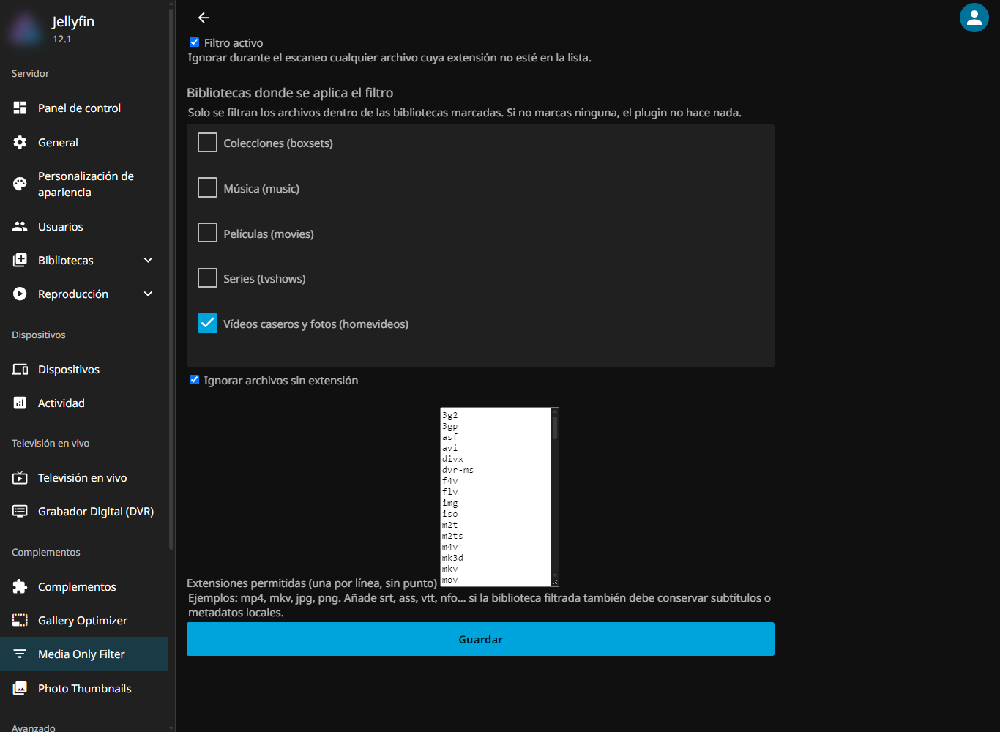

# Jellyfin.Plugin.MediaOnly

Plugin para **Jellyfin** que ignora, durante el escaneo de bibliotecas,
cualquier archivo cuya extensión **no sea de vídeo o imagen**.

Sirve para mantener limpias las bibliotecas de fotos/vídeos personales (por
ejemplo, las que se sincronizan desde el móvil) sin que entren documentos,
`.zip`, `.tmp`, `.ini`, cachés u otros ficheros extraños que el escáner
indexaría como elementos desconocidos.



## Qué hace

Implementa `IResolverIgnoreRule` (`MediaBrowser.Controller.Resolvers`), la
interfaz que Jellyfin usa para decidir si una ruta entra en una biblioteca.
El servidor descubre automáticamente las implementaciones de los plugins
instalados:

- **Directorios**: nunca se ignoran (el escáner sigue bajando por el árbol).
- **Solo afecta a las bibliotecas marcadas**: el filtro se aplica únicamente
  dentro de las bibliotecas seleccionadas (resueltas por su ruta física). Las
  demás se comportan como siempre — subtítulos `.srt`/`.ass`/`.vtt`, `.nfo` y
  demás metadatos intactos.
- **Extensión permitida** → el archivo se procesa con normalidad.
- **Extensión no permitida o sin extensión** → el archivo se ignora por
  completo: ni siquiera aparece como item en la biblioteca.
- **Lista de bibliotecas vacía** → el plugin no filtra nada (estado neutro).

## Configuración

En **Panel → Plugins → Media Only Filter**:

| Opción | Por defecto | Descripción |
|---|---|---|
| Filtro activo | ✅ | Activa/desactiva la regla por completo. |
| Bibliotecas donde se aplica | *(ninguna)* | El filtro solo actúa dentro de las marcadas. Vacío = no filtra nada. |
| Ignorar archivos sin extensión | ✅ | Los ficheros sin extensión también se descartan. |
| Extensiones permitidas | lista vídeo+imagen | Una extensión por línea, sin punto. Se normalizan a minúsculas. |

### Extensiones por defecto

- **Vídeo**: `mp4 mkv avi mov wmv m4v mpg mpeg ts m2ts mts vob webm flv 3gp 3g2 asf divx dvr-ms f4v iso img rm rmvb mxf strm …`
- **Imagen**: `jpg jpeg png gif bmp tif tiff webp heic heif avif jxl svg` +
  RAW (`cr2 cr3 nef arw dng raf orf rw2 …`)

> **Ojo**: si una biblioteca filtrada también necesita subtítulos o
> metadatos locales (`.srt`, `.ass`, `.vtt`, `.nfo`), añade esas extensiones
> a la lista. En las bibliotecas **no** seleccionadas Jellyfin los sigue
> admitiendo de forma normal.

## Instalación

### Opción A — Repositorio de plugins (recomendada)

1. **Panel → Plugins → Repositories → +** y añade:
   `https://nen155.github.io/jellyfin-plugins-repo/manifest.json`
2. En el catálogo, busca **Media Only Filter** e instálalo.
3. Reinicia Jellyfin, marca las bibliotecas a filtrar y guarda.
4. Lanza un escaneo de esas bibliotecas.

Las actualizaciones futuras se ofrecen automáticamente desde el mismo panel.

### Opción B — Manual

1. Detén Jellyfin.
2. Crea la carpeta `MediaOnlyFilter` dentro del directorio de plugins:
   - Windows (instalador): `%ProgramData%\Jellyfin\Server\plugins\MediaOnlyFilter\`
   - Windows (portable): `<jellyfin>\data\plugins\MediaOnlyFilter\`
   - Linux/Docker: `<config>/plugins/MediaOnlyFilter/`
3. Copia dentro **solo** `Jellyfin.Plugin.MediaOnly.dll`
   (las DLLs `Jellyfin.Controller`/`Jellyfin.Model`/`Jellyfin.Data` ya las
   aporta el servidor).
4. Arranca, verifica en **Panel → Plugins** que aparece *Activo* y ejecuta
   un escaneo de las bibliotecas elegidas.

## Compilación

Requiere **.NET SDK 10**:

```powershell
dotnet publish -c Release
```

El ensamblado queda en
`bin\Release\net10.0\publish\Jellyfin.Plugin.MediaOnly.dll`.

## Compatibilidad

- Compilado contra **Jellyfin 12.1** (`Jellyfin.Controller`/`Jellyfin.Model`
  12.1.x, `net10.0`; `targetAbi: 12.1.0.0` en `build.yaml`).
- Para otra versión del servidor, ajusta `TargetFramework`, las versiones de
  los `PackageReference` del `.csproj` y `targetAbi` en `build.yaml`.

## Licencia

[GPL-2.0](LICENSE)
